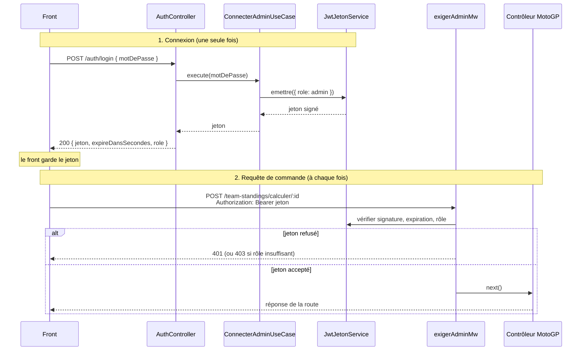

# Feature `auth` : protection des routes de commande

> Module d'authentification minimal, autonome et réutilisable, qui sépare les **visiteurs en lecture simple** de la **partie gestion réservée à l'admin**.

---

## 1. Contexte et besoin

L'API MotoGP expose deux familles de routes :

| Famille | Exemples | Qui y accède |
|---|---|---|
| **Lecture** (`GET`) | classements pilotes, classements équipes | Tout le monde, sans connexion |
| **Commande** (`POST`, `PUT`, `PATCH`, `DELETE`) | calcul d'un classement, saisie de données | L'admin uniquement |

Le besoin de départ est limité : **un middleware admin devant les routes de commande**. Les visiteurs du site consultent les données, la gestion reste fermée.

---

## 2. Décision : un système volontairement simple

Plutôt que de construire d'emblée un système complet (comptes, rôles multiples, mots de passe hachés en base), le choix est de partir sur le minimum qui répond au besoin :

- **un seul compte admin**, dont le mot de passe est stocké dans une variable d'environnement ;
- **un jeton JWT** délivré à la connexion, qui porte le rôle ;
- **un middleware** qui vérifie ce jeton avant les routes de commande.

**Pourquoi ce choix :**

- il répond au besoin réel, sans fonctionnalités inutilisées ;
- il reste compréhensible de bout en bout, ce qui compte dans un projet d'étude ;
- il laisse la place à une **évolution** : le sujet de l'authentification sera approfondi plus tard avec un modèle de connexion complet. L'architecture actuelle est pensée pour que ce remplacement se fasse sans toucher au reste de l'application.

> Cette version est un **stub volontaire** : elle est isolée derrière des ports pour être remplacée, pas pour durer.

---

## 3. Un module complémentaire, indépendant du MotoGP

Le domaine `auth` n'a pas pour but de faire tourner l'API : il l'**encadre**. Il se décrit sans aucun mot du vocabulaire MotoGP (pas de pilote, de circuit ni de classement).

- Le MotoGP **peut exister sans `auth`** : les routes de lecture fonctionneraient telles quelles.
- `auth` **peut exister sans le MotoGP** : il peut être repris tel quel dans un autre projet.
- Les dépendances vont **dans un seul sens** : une route MotoGP utilise `auth`, jamais l'inverse.
- Il se **greffe par le bootstrap** : le module MotoGP ne connaît pas `auth`, il reçoit simplement une étape à intercaler dans ses routes.

En termes de domaine, c'est un **sous-domaine générique** (comme la facturation ou le stockage de fichiers pourraient l'être) : un besoin que tout projet a, qui n'est pas le cœur de métier.

---

## 4. Architecture

```
auth/
├── domaine/
│   └── ports/out/
│       └── jeton-service.port.ts        ← contrat : émettre / vérifier un jeton
├── application/
│   ├── ports/in/
│   │   ├── verifier-admin.port.ts       ← « ce mot de passe est-il le bon ? »
│   │   ├── connecter-admin.port.ts      ← « connecte-moi, donne-moi un jeton »
│   │   └── verifier-jeton.port.ts       ← « ce jeton est-il valide, quel rôle ? »
│   └── use-cases/
│       ├── verifier-admin.use-case.ts
│       ├── connecter-admin.use-case.ts
│       └── verifier-jeton.use-case.ts
└── adapters/
    ├── in/http/
    │   ├── auth.controller.ts           ← routes et handlers (login, session)
    │   └── exiger-admin.middleware.ts   ← l'étape intercalée dans les routes
    └── out/jwt/
        └── jwt-jeton.service.ts         ← implémentation du port avec jsonwebtoken
```

### Rôle de chaque couche

| Couche | Contient | Règle |
|---|---|---|
| **Port** | Le contrat (interface) | Aucune technique, aucune librairie |
| **Use case** | La logique de l'application | Ne connaît que des ports |
| **Adaptateur** | HTTP, JWT, base de données | Seul endroit qui importe une librairie technique |

`JwtJetonService` n'est **pas** un service de domaine : il dépend de la librairie `jsonwebtoken`, donc c'est un adaptateur de sortie. Le critère qui décide de la couche d'un fichier est ce qu'il **importe**, pas la fin de son nom.

---

## 5. Le « ping-pong » du JWT

Le principe tient en deux temps : **le serveur délivre une preuve à la connexion, le client la renvoie à chaque requête**.



### Ce qui voyage, et ce qui ne voyage jamais

| Élément | Voyage dans la requête ? | Rôle |
|---|---|---|
| **Le mot de passe** | Une seule fois, au login | Prouver l'identité |
| **Le jeton** | À chaque requête, en en-tête | Porter le rôle, signé par le serveur |
| **`JWT_SECRET`** | **Jamais** | Signer le jeton et le vérifier, il reste côté serveur |

Le jeton est une **déclaration signée** (« rôle admin, valable jusqu'à telle heure »). Le serveur la croit parce que seul lui possède le secret capable de produire cette signature. Pour vérifier, il **recalcule** la signature et compare : il ne consulte aucune base. Le système est *stateless*.

Le contenu d'un jeton se lit (il n'est pas chiffré) : on n'y met donc jamais de donnée sensible. Exemple de contenu décodé :

```json
{ "role": "admin", "iat": 1791961258, "exp": 1791964858 }
```

`iat` est l'heure d'émission, `exp` l'heure d'expiration.

---

## 6. Authentification et autorisation

Deux étapes distinctes, deux use cases distincts :

| Étape | Question | Use case |
|---|---|---|
| **Authentification** | Qui es-tu ? (le mot de passe est-il bon ?) | `ConnecterAdminUseCase` |
| **Autorisation** | As-tu le droit de faire ça ? (le jeton porte-t-il le rôle admin ?) | `VerifierJetonUseCase` + middleware |

---

## 7. Endpoints

| Méthode | Route | Protégée | Rôle |
|---|---|---|---|
| `POST` | `/auth/login` | Non | Connexion : retourne un jeton |
| `GET` | `/auth/session` | Oui | Indique au front s'il est toujours connecté |

> Le préfixe (`/auth`) dépend du montage dans le bootstrap : `app.use('/auth', authController.creerRouter(exigerAdminMw))`.

**Connexion**

```http
POST /auth/login
Content-Type: application/json

{ "motDePasse": "..." }
```

```json
{ "jeton": "eyJhbGciOi...", "expireDansSecondes": 3600, "role": "admin" }
```

**Appel d'une route protégée**

```http
GET /auth/session
Authorization: Bearer eyJhbGciOi...
```

```json
{ "role": "admin" }
```

### Codes de réponse

| Code | Message | Signification |
|---|---|---|
| `200` | | Succès |
| `400` | `motDePasse requis` | Corps absent, champ manquant ou vide |
| `401` | `Identifiants invalides` | Mauvais mot de passe au login |
| `401` | `Non authentifié` | Aucun jeton exploitable dans l'en-tête `Authorization` |
| `401` | `Jeton invalide ou expiré` | Jeton lu, mais signature fausse ou date dépassée |
| `403` | `Accès refusé` | Jeton valide, mais rôle insuffisant (prévu pour les futurs rôles) |

---

## 8. Le middleware : une étape intercalée

`exigerAdmin` est en deux niveaux :

```typescript
export const exigerAdmin = (verifierJeton) => async (req, res, next) => { ... };
//           ^ fabrique, appelée une fois au démarrage   ^ l'étape elle-même, exécutée par Express à chaque requête
```

- la **fabrique** reçoit son port de vérification (injection, comme un use case reçoit ses repositories) ;
- **l'étape** reçoit `req`, `res`, `next` : elle répond elle-même (401/403) ou appelle `next()` pour passer au handler.

Le contrôleur MotoGP n'appelle jamais le middleware : il le **place dans la route**, devant son handler.

```typescript
router.get('/team-standings', controller.lister);                                       // publique
router.post('/team-standings/calculer/:eventId', exigerAdminMw, controller.calculer);   // admin
```

---

## 9. Configuration

Fichier `.env` (jamais commité, présent dans `.gitignore`) :

| Variable | Rôle | Contrainte |
|---|---|---|
| `ADMIN_PASSWORD` | Mot de passe admin | Obligatoire |
| `JWT_SECRET` | Secret de signature des jetons | Obligatoire, 32 caractères minimum |
| `JWT_DUREE_SECONDES` | Durée de validité du jeton | Optionnelle, 3600 par défaut |

Un fichier `.env.example` sans valeur réelle sert de modèle. Les variables sont lues **une seule fois**, dans le bootstrap, jamais dans la logique applicative.

---

## 10. Choix de sécurité

- **Comparaison à temps constant** du mot de passe : `crypto.timingSafeEqual`, qui évite qu'une comparaison s'arrête au premier caractère différent. Cette fonction exige deux buffers de même longueur : les deux valeurs passent donc par un hachage SHA-256 pour normaliser la longueur. Ce hachage ne protège pas un mot de passe, il sert uniquement à égaliser les tailles. Référence : [documentation Node.js `crypto`](https://nodejs.org/api/crypto.html#cryptotimingsafeequala-b).
- **Algorithme imposé** à la vérification (`HS256`) : un jeton non signé (`alg: none`) ou signé autrement est refusé.
- **Secret d'au moins 32 caractères**, vérifié à la construction.
- **Démarrage refusé** si `ADMIN_PASSWORD` ou `JWT_SECRET` manque : mieux vaut une application qui ne démarre pas qu'un accès admin cassé ou ouvert.
- **Jeton en en-tête** (`Authorization: Bearer`) et non en paramètre d'URL, qui finirait dans les journaux.
- **Rôle validé** : un jeton valide dont le rôle est inconnu ou absent est refusé.

---

## 11. Limites connues

| Limite | Conséquence | Évolution possible |
|---|---|---|
| Un seul compte, un seul mot de passe | Pas de traçabilité par utilisateur | Module complet avec comptes |
| Pas de limite de tentatives sur `/auth/login` | Essais de mots de passe en boucle possibles | `express-rate-limit` |
| Pas de révocation côté serveur | Un jeton reste valable jusqu'à son expiration | Liste de sessions (base ou Redis) |
| Un seul rôle (`admin`) | Le `403` n'est pas encore exercé | Élargir `RoleAuth` |
| Pas de jeton de rafraîchissement | Reconnexion à l'expiration | *Refresh token* |
| Jeton conservé côté front | Exposé en cas de faille XSS si stocké dans `localStorage` | Cookie `HttpOnly` |

**Côté front :** masquer les pages admin relève de l'ergonomie, pas de la sécurité. La protection réelle est celle de l'API : sans jeton valide, les requêtes de commande sont refusées, quelle que soit la page affichée.

---

## 12. Évolution : le futur module hexagonal complet

Le stub actuel sera remplacé, sans toucher aux routes MotoGP ni au middleware, par un module complet :

- une couche **`domaine/`** avec ses entités et règles propres : utilisateurs, rôles, politique de mot de passe, verrouillage après échecs ;
- un **hachage de mots de passe** adapté (argon2 ou bcrypt), à ne pas confondre avec le SHA-256 de normalisation actuel ;
- un **port de persistance** (`UtilisateurRepositoryPort`) : les données d'authentification peuvent vivre dans une autre base, ou un autre type de stockage, sans impact sur le reste ;
- un port `VerifierJetonPort` enrichi, qui retournera l'identité complète plutôt qu'un simple rôle.

Le seul vrai point de contact avec le reste de l'application reste **le port**. C'est lui, et lui seul, qui devra évoluer.

---

## 13. Réutiliser le module dans un autre projet

1. Copier le dossier `auth/` dans le `src/` du projet.
2. Installer la dépendance : `npm install jsonwebtoken` puis `npm install -D @types/jsonwebtoken`.
3. Créer le `.env` à partir de `.env.example` et ajouter `.env` au `.gitignore`.
4. Dans le bootstrap : instancier `JwtJetonService`, `VerifierAdminUseCase`, `ConnecterAdminUseCase`, `VerifierJetonUseCase`, `AuthController` et `exigerAdmin`, puis monter `app.use(express.json())` et le router d'auth.
5. Placer `exigerAdminMw` devant les routes de commande.

Aucun import ne pointe vers un module métier : le dossier est autonome.

---

## 14. Tests

La suite Vitest couvre chaque couche, sans base de données ni serveur :

| Fichier | Ce qui est vérifié |
|---|---|
| `verifier-admin.use-case.test.ts` | Bon et mauvais mot de passe, chaîne vide, longueurs différentes sans exception |
| `connecter-admin.use-case.test.ts` | Jeton délivré si mot de passe valide, aucun jeton sinon |
| `verifier-jeton.use-case.test.ts` | Contenu retourné si valide, `null` sinon |
| `jwt-jeton.service.test.ts` | Émission, secret trop court, jeton expiré, falsifié, `alg: none`, rôle inconnu |
| `exiger-admin.middleware.test.ts` | 401, 403, `next()`, formats d'en-tête invalides, erreur propagée |
| `auth.controller.test.ts` | 200, 400, 401, erreur propagée, routes déclarées |

```bash
npx vitest run auth
```

---

## Résumé

> Un middleware admin protège les routes de commande. Le mot de passe n'est envoyé qu'une fois : le serveur répond par un jeton signé qui porte le rôle, que le client renvoie à chaque requête et que le serveur valide sans rien stocker. La solution est volontairement minimale, isolée derrière des ports dans un module indépendant du MotoGP, pour être remplacée par un modèle de connexion complet sans toucher au reste de l'application.
