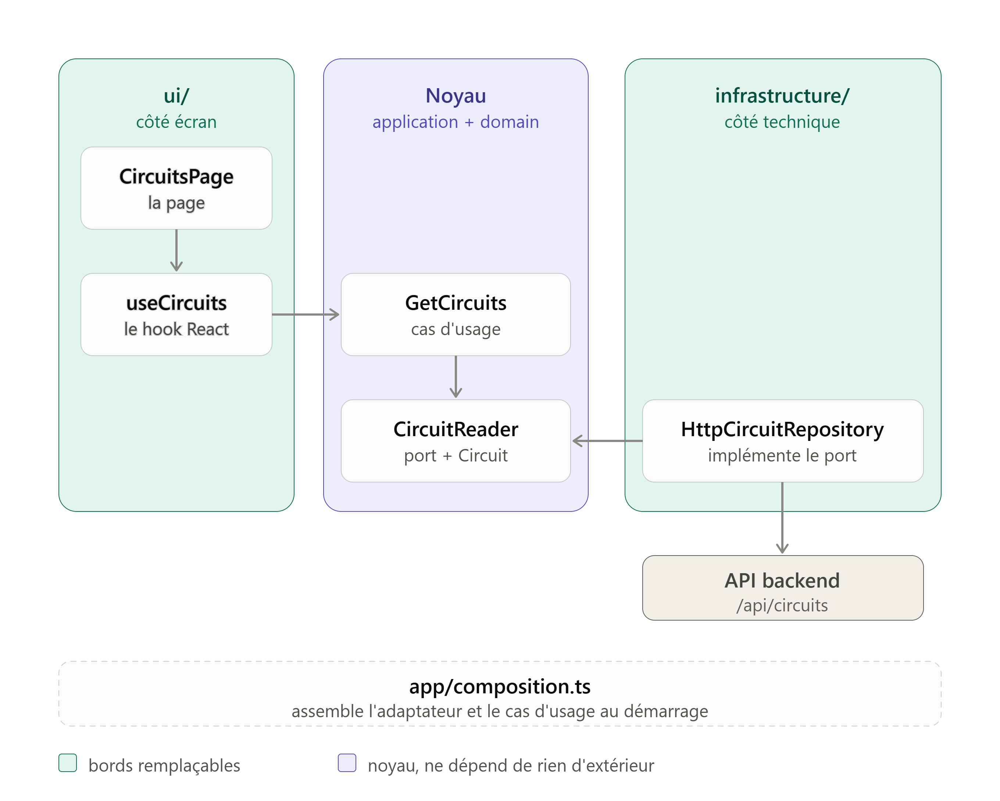

# Architecture du frontend : hexagonale par modules

> **Statut** : version 0.1, octobre 2026.
> **Tranche de référence** : `circuits` (lecture seule). 
> **À corriger** après la deuxième tranche, plus exigeante (`riderStandings`, qui croise pilotes, événements et circuits).

## 1. Principe

Le frontend (React + TypeScript, Vite) reprend la logique du backend : découpage par entité, puis par couche. Deux axes indépendants se combinent :

| Axe | Question à laquelle il répond | Se traduit par |
| --- | --- | --- |
| Slice verticale | Dans quel module ranger ce fichier ? | `modules/circuits/`, `modules/rider/`, … |
| Hexagonale | De quoi ce fichier a-t-il le droit de dépendre ? | `domain/`, `application/`, `infrastructure/`, `ui/` |

**Règle centrale : le noyau ne dépend de rien d'extérieur, tout le reste dépend de lui.** Elle se vérifie par les imports (section 4).

Avant de créer un fichier, deux questions : *dans quel module ?* puis *dans quelle couche ?* Si l'une des deux reste sans réponse, le fichier mélange probablement deux responsabilités.

**Critère de lisibilité** : une personne qui découvre le projet doit retrouver en moins d'une minute où se change l'affichage de la liste des circuits, et où se fait l'appel à l'API.

## 2. Structure

```
src/
├── app/                          assemblage, hors des modules
│   ├── composition.ts            branche adaptateurs et cas d'usage
│   ├── router.tsx                table des routes
│   ├── Layout.tsx                bannière avec bouton Accueil + <Outlet />
│   └── HomePage.tsx              grille d'accès aux sections
│
└── modules/
    └── circuits/
        ├── domain/
        │   ├── Circuit.ts                  modèle (interface)
        │   └── CircuitRepository.ts        port : CircuitReader
        ├── application/
        │   └── GetCircuits.ts              cas d'usage : consulter la liste
        ├── infrastructure/
        │   └── HttpCircuitRepository.ts    adaptateur : fetch vers /api/circuits
        └── ui/
            ├── useCircuits.ts              hook React : états chargement/erreur/liste
            └── CircuitsPage.tsx            page liste (nom, pays, photo)
```

**Prévu** : une page de détail (`/circuits/:id`) qui affichera la longueur et le nombre de virages, avec un `getById` dans le port. Quand l'espace admin reviendra, il vivra **à l'intérieur** des modules (sous-dossiers `admin/` de `application/` et `ui/`), pas dans un module `admin/` séparé : le modèle, le port et l'adaptateur sont communs aux deux publics.

## 3. Les couches

| Couche | Rôle | Exemple (`circuits`) | Peut importer |
| --- | --- | --- | --- |
| `domain/` | Ce qu'est une chose, et ce dont on a besoin pour la lire ou l'écrire | `Circuit`, `CircuitReader` | rien d'extérieur |
| `application/` | Une intention : « consulter les circuits » | `GetCircuits` | `domain/` |
| `infrastructure/` | Le monde extérieur : réseau, stockage | `HttpCircuitRepository` | `domain/` |
| `ui/` | Affichage et hooks React | `CircuitsPage`, `useCircuits` | `application/` (types), `domain/` |
| `app/` | Assemblage de l'ensemble | `composition.ts`, routeur | tout |

**Le domaine front est un modèle de lecture.** Les règles métier (barème des points, validation des contrats, classements) restent dans le backend, qui est l'autorité. Le front les consulte et les affiche sans les dupliquer, sous peine d'avoir deux sources de vérité qui divergent.

**Ne pas confondre** : `use…` en minuscule (`useCircuits`) est une convention React et vit dans `ui/`. Un nom d'action (`GetCircuits`, `CreateCircuit`) est un cas d'usage et vit dans `application/`.

## 4. Règles d'import

| Couche | Autorisé | Interdit |
| --- | --- | --- |
| `domain/` | rien d'extérieur | React, `fetch`, `application/`, `infrastructure/`, `ui/` |
| `application/` | `domain/` | React, `infrastructure/`, `ui/` |
| `infrastructure/` | `domain/` | React, `application/`, `ui/` |
| `ui/` | `application/` (types), `domain/` | `infrastructure/`, `app/` |
| `modules/` (tous) | leur propre contenu | `app/` |
| `app/` | tous les modules | |

Les imports entre deux modules (par exemple `riderStandings` qui lit `circuits`) ne sont **pas encore tranchés** : règle à définir avec la deuxième tranche.

## 5. Chemin d'une donnée

```
CircuitsPage ─► useCircuits ─► GetCircuits ─► CircuitReader ◄─ HttpCircuitRepository ─► API
    ui/            ui/        application/      domain/            infrastructure/
```

- Les flèches de gauche sont des **appels** (l'écran déclenche, le cas d'usage orchestre).
- La flèche `HttpCircuitRepository → CircuitReader` indique que l'adaptateur **implémente** le port. C'est l'inversion de dépendance : le noyau déclare ce dont il a besoin, la technique s'y plie.
- `ui/` et `infrastructure/` sont symétriques : l'un déclenche, l'autre exécute, et chacun est remplaçable sans toucher au noyau.

## 6. La composition root

`app/composition.ts` est le seul fichier qui connaît à la fois les adaptateurs et les cas d'usage :

```ts
const circuitRepository = createHttpCircuitRepository()

export const getCircuits = createGetCircuits(circuitRepository)
```

Le routeur importe ce fichier et passe les cas d'usage aux pages **en props** :

```tsx
<Route path="/circuits" element={<CircuitsPage getCircuits={getCircuits} />} />
```

Conséquences :

- Les modules n'importent jamais `app/` : le sens reste `app → modules`.
- Une page ne peut pas s'afficher sans son cas d'usage, ce que TypeScript vérifie.
- Pour tester sans réseau, il suffit de fournir un faux lecteur au même cas d'usage :

```ts
const fake: CircuitReader = { getAll: async () => [/* circuits de test */] }
const getCircuits = createGetCircuits(fake)
```

## 7. Où ranger une règle ?

Question à se poser : **qu'est-ce qui la ferait changer ?**

| Elle change parce que… | Elle va dans | Exemple |
| --- | --- | --- |
| le métier évolue | `domain/` | un circuit doit avoir au moins un virage |
| l'usage ou l'écran évolue | `application/` | trier les circuits par nom |
| la technique évolue | `infrastructure/` | l'URL `/api/circuits`, le jeton d'authentification |
| la présentation évolue | `ui/` | afficher `4,66 km`, les classes Tailwind |

## 8. Recette : ajouter un module (lecture)

1. **Nommer** le module d'après l'entité du backend (même vocabulaire des deux côtés).
2. `domain/<Entité>.ts` : une `interface` qui décrit exactement le JSON renvoyé par l'API.
3. `domain/<Entité>Repository.ts` : le port de lecture (`getAll()`, puis `getById()` quand une page en a besoin).
4. `infrastructure/Http<Entité>Repository.ts` : une fonction qui renvoie l'adaptateur. Toujours tester `response.ok` et lever une erreur sinon.
5. `application/Get<Entités>.ts` : une fonction qui reçoit le port. Rester mince : n'y mettre que de la vraie logique d'usage.
6. `ui/use<Entités>.ts` : le hook, avec les trois états (chargement, erreur, succès) et un indicateur d'annulation dans le `useEffect`.
7. `ui/<Entités>Page.tsx` : la page, qui reçoit le cas d'usage en prop.
8. `app/composition.ts` : instancier l'adaptateur et exporter le cas d'usage.
9. `app/router.tsx` : déclarer la route et passer le cas d'usage ; ajouter l'entrée sur la page d'accueil.
10. `vite.config.ts` : si l'API expose un **nouveau préfixe public** (par exemple `/uploads` pour les images), ajouter une entrée au proxy, puis relancer Vite.
11. Vérifier : `npx tsc -b` et `npm run lint`.

Quand l'espace admin reviendra : ajouter le port d'écriture, un cas d'usage dans `application/admin/`, une page dans `ui/admin/`, et protéger la route dans `app/`. La protection côté front est de l'ergonomie, pas de la sécurité : le backend doit refuser les écritures sans le bon rôle.

## 9. Décisions

| # | Décision | Raison |
| --- | --- | --- |
| D1 | Les modèles sont des **interfaces**, pas des classes | `res.json()` renvoie des objets simples, pas des instances ; `erasableSyntaxOnly` interdit les propriétés de paramètre dans les constructeurs |
| D2 | Cas d'usage et adaptateurs sont des **fonctions-fabriques** | même contrainte de configuration, et une fonction suffit |
| D3 | Les cas d'usage arrivent aux pages **en props** | les modules n'importent pas `app/` ; la page reste testable avec un faux |
| D4 | Cas d'usage de lecture volontairement **minces** | pas de logique inventée ; choix d'étude assumé, à reconsidérer si le gabarit paraît trop lourd |
| D5 | À l'arrivée de l'admin : **sous-dossiers** `admin/` dans les modules | évite de dupliquer modèle, port et adaptateur |
| D6 | À l'arrivée de l'écriture : ports de **lecture et d'écriture séparés** | une page publique ne dépend que de la lecture |
| D7 | Chaque préfixe public du backend a une entrée dans le **proxy Vite** | sinon le navigateur le cherche sur son propre port (cas rencontré avec `/uploads`) |
| D8 | Le domaine front est un **modèle de lecture** | le backend reste l'autorité sur les règles métier |
| D9 | La **liste** n'affiche que nom, pays et photo ; longueur et virages relèvent d'une **page de détail** | une carte de liste reste lisible ; le détail demandera un `getById` |

## 10. Compromis et limites connues

- **JSON non validé à l'exécution** : l'adaptateur affirme `as Circuit[]` sans vérifier. Un champ renommé côté backend casserait l'affichage sans erreur de compilation. Piste : validation par schéma (zod) dans l'adaptateur.
- **Pas d'authentification ni d'écriture** : retirées pour l'instant, à traiter avec l'espace admin.
- **Décimales parasites** : `longueurKm` arrive sous la forme `4.659999847412109` (colonne `FLOAT` côté backend). À corriger côté base (`DECIMAL`) ; en attendant, formater à l'affichage, dans la page de détail qui montrera ce champ.
- **Règles d'import non vérifiées automatiquement** : voir section 11.
- **Imports entre modules** non tranchés (section 4).
- **Pas encore de tests**.

## 11. Vérification automatique des imports (à mettre en place)

Sans contrôle outillé, les règles de la section 4 n'existent que dans les têtes. La règle `no-restricted-imports` d'ESLint permet de les faire respecter. Exemple à ajouter à la configuration ESLint du frontend (**à adapter et à tester** : cet extrait n'a pas encore été essayé sur le projet) :

```js
{
  files: ['src/modules/*/domain/**/*.{ts,tsx}'],
  rules: {
    'no-restricted-imports': ['error', {
      patterns: [
        { group: ['react', 'react-dom', 'react-dom/*', 'react-router'],
          message: 'Le domaine ne dépend pas de React.' },
        { group: ['**/application/**', '**/infrastructure/**', '**/ui/**'],
          message: 'Le domaine ne dépend d\'aucune autre couche.' },
      ],
    }],
  },
},
{
  files: ['src/modules/*/application/**/*.{ts,tsx}'],
  rules: {
    'no-restricted-imports': ['error', {
      patterns: [
        { group: ['react', 'react-dom', 'react-dom/*', 'react-router'],
          message: 'L\'application ne dépend pas de React.' },
        { group: ['**/infrastructure/**', '**/ui/**'],
          message: 'L\'application ne connaît que le domaine.' },
      ],
    }],
  },
},
{
  files: ['src/modules/*/ui/**/*.{ts,tsx}'],
  rules: {
    'no-restricted-imports': ['error', {
      patterns: [
        { group: ['**/infrastructure/**'],
          message: 'L\'UI passe par les cas d\'usage, jamais par l\'infrastructure.' },
      ],
    }],
  },
},
```

## 12. À valider avec la deuxième tranche

- [ ] Page de détail `/circuits/:id` : `getById` dans le port, cas d'usage dédié, `useParams` dans la page.
- [ ] La structure tient-elle quand un module a besoin des données d'un autre ?
- [ ] `composition.ts` reste-t-il lisible avec plusieurs modules, ou faut-il le découper ?
- [ ] Un cas d'usage de lecture justifie-t-il enfin sa couche (assemblage de plusieurs appels, tri, regroupement) ?
- [ ] Les règles d'import sont-elles outillées ?
- [ ] Cette recette a-t-elle suffi pour réaliser la tranche **sans rouvrir le code de `circuits`** ? Sinon, noter ce qui manquait.

