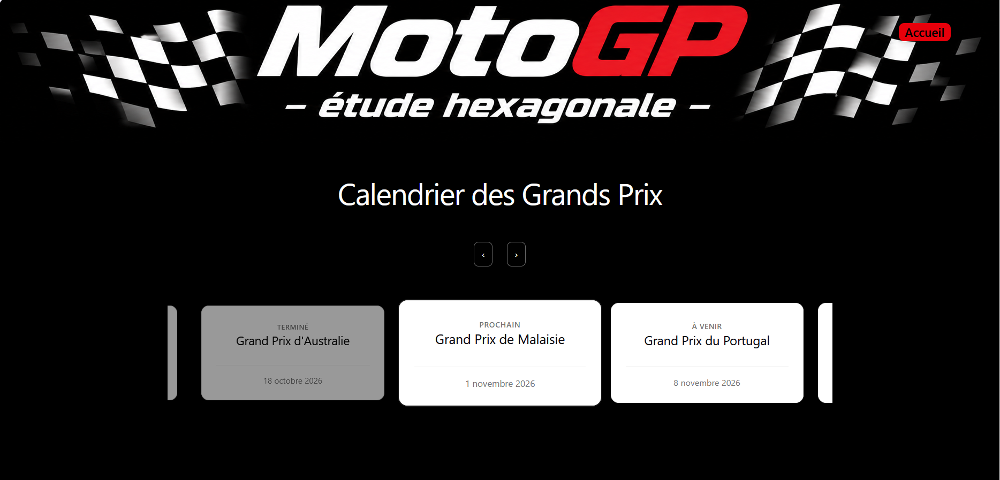
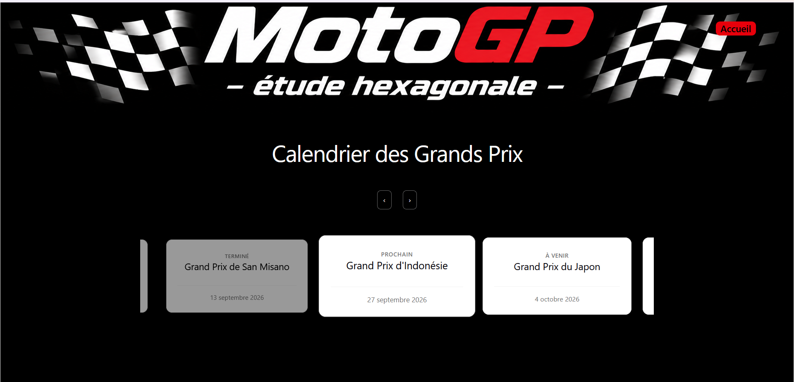

# Feature raceEvent : calendrier des Grands Prix

## 1. Objectif
Ce que le visiteur voit en un coup d'œil (le prochain événement au centre,
les passés ternes, les futurs en clair).

## 2. Structure des fichiers
L'arbre du module, une ligne par fichier.

## 3. Le chemin d'une donnée
Page → hook → cas d'usage (tri par date) → adaptateur → API.

## 4. La règle « prochain événement »
Comment on le trouve, et où cette règle vit (application, pas la page).

## 5. Décisions
- Statut ou date pour déterminer le prochain ? Ton choix, et la raison.
- `statut` non readonly : pourquoi (fonctionnalité admin à venir).
- Données de support non tenues à jour : conséquence sur l'affichage.

## 6. Le slider
Défilement avec scroll-snap, références sur les cartes, remplissage latéral
pour centrer, boutons. Une phrase par choix.

## 7. Limites connues
- Statuts de la base périmés (Indonésie, Japon, Australie) tant qu'elle n'est pas mise à jour.
- Pas de tests.

## 8. Captures

En se fixant sur la date actuelle.

En se fixant sur le statut enregistré dans la bdd

